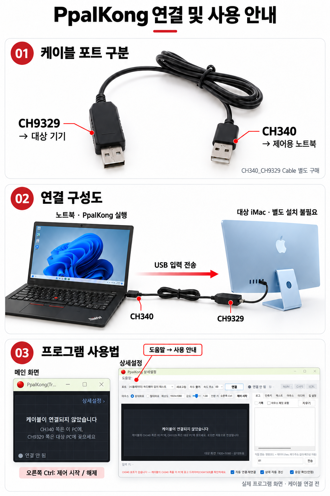

# PpalKong

**씽크패드 노트북을 ThinkPad TrackPoint Keyboard처럼 사용하는 KM(Keyboard Mouse) 애플리케이션입니다.**

노트북의 키보드와 트랙포인트 입력을 CH340/CH9329 케이블을 통해 다른 PC나 기기로 전달합니다. 프로그램은 제어용 Windows 노트북에서만 실행하며, 대상 기기에는 별도의 소프트웨어를 설치할 필요가 없습니다.

## 다운로드

**[최신 버전 다운로드 — Releases](https://github.com/yanghanjin-dev/PpalKong/releases/latest)**

1. 일반 설치는 Releases의 **`PpalKong-Setup-0.1.6.exe`**를 받아 실행하세요.
2. 기본 설치 위치는 `%LOCALAPPDATA%\Programs\PpalKong`이며 관리자 권한 없이 현재 사용자용으로 설치합니다. 언어팩이 함께 설치됩니다.
3. 시작 메뉴에서 PpalKong을 실행하세요. 설치 중 바탕 화면 바로가기를 선택할 수도 있습니다.

설치 없이 사용하려면 `PpalKong-0.1.6-Windows.zip`을 모두 풀고 `PpalKong.exe`를 실행하세요. `languages` 폴더를 함께 유지하세요. 기존 ZIP 사용자도 설치 EXE를 실행하면 기존 설정을 이어 사용할 수 있습니다.

## 프로그램 제거

먼저 트레이 아이콘의 **종료**로 PpalKong을 종료하세요. **Windows 설정 → 앱 → 설치된 앱 → PpalKong → 제거** 또는 시작 메뉴의 PpalKong 제거 항목을 사용합니다. 실행 중에는 설치·제거를 진행하지 않으며 앱을 강제 종료하지 않습니다.

설정(`%USERPROFILE%\.ppalkong.ini`), 사용자 추가 파일·언어팩·로그·복구 백업은 유지합니다. 남은 사용자 파일이 있으면 설치 폴더가 남을 수 있습니다. 설치·제거 자체에는 PowerShell이 필요하지 않습니다. 설치형은 Windows 10/11 x64 호환 환경용이며 CH340 드라이버는 별도로 준비하세요.

## 연결 및 사용 안내

안내 이미지 속 화면은 0.1.2 기준이며 케이블 연결 전 상태입니다. 현재 버전에서는 상세설정의 도움말 옆 **언어 / Language** 메뉴로 언어를 즉시 변경할 수 있습니다.

## 준비물

**CH340_CH9329 Cable이 반드시 필요하며, 인터넷에서 별도로 구매해야 합니다.**

## 연결 방법

| 케이블 포트 | 연결할 기기 |
|---|---|
| **CH340** | PpalKong을 실행할 씽크패드 노트북(제어 PC) |
| **CH9329** | 키보드·마우스 입력을 받을 대상 PC 또는 기기 |

노트북 → CH340 → 케이블 → CH9329 → 대상 기기

## 사용 방법

1. 위의 연결 방향에 맞게 케이블을 꽂습니다.
2. 제어용 노트북에서 PpalKong을 실행합니다. 포트와 통신 속도를 자동으로 찾습니다.
3. 연결 후 **오른쪽 Ctrl을 눌렀다 떼면** 대상 기기 제어가 시작됩니다.
4. **오른쪽 Ctrl을 다시 누르면** 제어를 해제합니다. 전환 키는 상세설정에서 변경할 수 있습니다.
5. **상세설정 → 도움말 → 사용 안내**에서 케이블 사진과 자세한 설명을 확인하세요. 메뉴 이름은 선택한 언어에 따라 달라집니다.

COM 포트가 나타나지 않으면 CH340 쪽이 노트북에 연결되었는지 확인하고, CH340 드라이버 설치 상태를 확인하세요.

## 지원 환경

- **제어 기기:** PpalKong을 실행하는 Windows 씽크패드 노트북
- **대상 기기:** 유선 USB 키보드·마우스 입력을 지원하는 PC, macOS 기기, Android 기기, 스마트폰 등
- **BIOS/CMOS/UEFI:** 해당 설정 화면에서 USB 키보드·마우스 입력을 지원하는 경우 사용 가능
- **스마트폰 등:** USB 호스트(OTG) 지원과 단자에 맞는 변환 어댑터가 필요할 수 있음

대상 기기에는 별도의 소프트웨어가 필요하지 않습니다. 실제 호환성은 대상 기기와 화면의 USB 입력 지원에 따라 달라지며, 모든 기기에서의 동작을 검증한 것은 아닙니다.

## 언어 지원

한국어, 영어, 일본어, 중국어 간체 UI와 도움말을 제공합니다. 상세설정의 도움말 옆 **언어 / Language** 메뉴에서 언어를 선택하고 저장하면 재실행 없이 바로 적용됩니다. 입력 내용과 선택값, 장치 연결은 유지됩니다. 기존 로그와 이미지 내부의 한국어 문구는 그대로 유지됩니다. 번역이 없는 언어는 영어로 표시됩니다.

## 자동 업데이트

0.1.5부터 **상세설정 → 업데이트 → 업데이트 확인**으로 새 버전을 확인할 수 있습니다. **업데이트 자동 확인**은 기본으로 켜져 있으며 하루 한 번 최신 정식 버전을 확인합니다. 자동 확인은 메뉴에서 끌 수 있습니다.

새 버전이 있으면 다운로드와 설치를 각각 선택합니다. 대상 PC 제어 중에는 안내와 설치를 미루며, 설치 시 앱이 종료된 뒤 실행 파일과 필수 언어팩을 함께 갱신하고 다시 실행합니다. 기존 설정은 유지됩니다. 다운로드한 ZIP의 SHA-256과 실행 파일 버전을 검증하고, 교체 오류 시 기존 파일로 복원합니다.

Windows PowerShell 5.1, 인터넷 연결과 프로그램 폴더 쓰기 권한이 필요합니다. `PpalKong.exe` 이름을 유지하세요. 쓰기 금지 폴더나 PowerShell 사용 제한 환경에서는 새 ZIP을 직접 받아 업데이트하세요. 0.1.4 이전 버전은 0.1.5를 한 번 직접 다운로드해야 합니다.

업데이트는 공식 GitHub HTTPS API와 배포 자산의 해시를 신뢰하며 별도 개발자 서명 검증은 제공하지 않습니다. 업데이트 요청에는 키보드·마우스 입력이나 설정·로그를 포함하지 않습니다. GitHub가 IP 주소 등 네트워크 요청 정보를 처리할 수 있습니다. 복구용 `.ppalkong-backup-*` 폴더가 앱 폴더에 남으며 전원 차단 중 파일 교체의 원자성은 보장하지 않습니다.

## 버전 및 변경 기록

- 현재 배포 버전: **0.1.6**
- 기능 개선마다 패치 버전을 1씩 올립니다: `0.1.2` → `0.1.3` → `0.1.4`.
- 버전에 맞춰 실행 파일을 새로 빌드하고, 검증 후 Releases에 배포합니다.
- 버전별 변경 내용, 검증 결과 및 알려진 제한은 각 Release 설명에 기록합니다.
- 이전 버전의 태그, Release와 배포 파일을 보존합니다.

### 0.1.6 주요 기능

- 한국어·영어·일본어·중국어 간체 UI
- 포트 구분·ThinkPad와 iMac 연결 구성도·실제 프로그램 화면을 포함한 도움말 안내 이미지
- 선택한 언어로 도움말 메뉴·제목·본문 표시
- 상세설정의 언어 메뉴 및 재실행 없는 즉시 언어 변경
- GitHub 새 버전 자동 확인, 사용자 선택으로 다운로드·검증·설치 및 재시작
- 사용자별 설치 EXE, 시작 메뉴 바로가기 및 Windows 앱 목록의 제거 기능

안내 이미지 내부 문구는 한국어이며, 이미지 속 화면은 0.1.2 기준의 케이블 연결 전 상태입니다.

빌드 및 언어 로딩 테스트를 통과했습니다. 실제 케이블 연결과 모든 대상 기기의 호환성 검증은 별도입니다.

## 저장소 운영

이 저장소는 **실행 파일 배포와 공개 사용 안내**를 위한 공간입니다. 배포 ZIP에는 실행 파일과 필수 언어팩이 포함되며, 소스·테스트·빌드 스크립트는 공개하지 않습니다.
